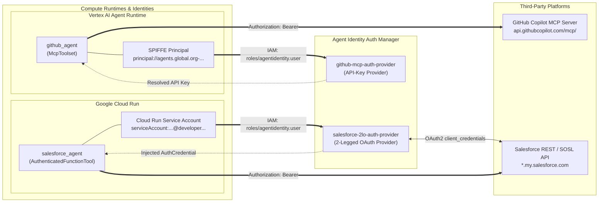

# Enterprise Multi-Agent Security: Zero-Secret Authentication with Google Cloud Agent Identity Auth Manager

[](https://cloud.google.com/vertex-ai)
[](https://google.github.io/adk-docs/)
[](https://google.github.io/adk-docs/)
[](https://spiffe.io/)

## Executive Summary

Enterprise AI agent systems routinely integrate with sensitive external platforms—such as GitHub source repositories and Salesforce document libraries—using API keys or OAuth 2.0 client credentials. Embedding these secrets in `.env` files or container environment variables introduces severe security risks: secrets travel with deployment bundles, are exposed to anyone who can inspect runtime configurations, and require full service redeployments whenever credentials rotate.

This repository implements a **Zero-Secret, Zero-Trust Credential Architecture** for a multi-agent system built with the **Google Agent Development Kit (ADK)** and **Google Cloud Agent Identity Auth Manager**:

- **Zero Hardcoded or Environment Secrets:** Neither agent stores an API key, OAuth consumer key, or client secret in source code, `.env` files, or container environment variables.
- **Workload Identity Authentication (SPIFFE & ADC):** Agents authenticate to the Google-managed Auth Manager vault using their own cryptographic runtime identities—a **SPIFFE principal** on Vertex AI Agent Runtime and a **Google Cloud Service Account** on Cloud Run.
- **Centralized Vault & Automatic Token Lifecycle:** Auth Manager stores static API keys and executes 2-Legged OAuth (2LO) `client_credentials` exchanges and token refreshes automatically.
- **Decoupled Credential Rotation & IAM Governance:** Credentials can be rotated in one place (`gcloud alpha agent-identity auth-providers update`) or revoked instantly via Google Cloud IAM (`roles/agentidentity.user`) without touching or redeploying any agent code.

---

## Repository Structure

```text
.
├── README.md                          # Production documentation, architecture & deployment guide
├── .gitignore                         # Excludes .env, build artifacts, and local caches
├── docs/
│   └── architecture.md                # Deep-dive architectural migration & sequence analysis
├── github-agent/                      # Vertex AI Agent Runtime specialist agent (SPIFFE + MCP)
│   ├── .env.example                   # Templated environment configuration (zero secrets)
│   ├── Dockerfile                     # Container build definition
│   ├── deploy_with_identity.sh        # Two-phase Agent Runtime SPIFFE provisioning & deploy script
│   └── agent/
│       ├── agent.py                   # ADK Agent with GcpAuthProvider, GcpAuthProviderScheme & McpToolset
│       ├── main.py                    # FastAPI A2A server with dynamic AgentCardBuilder
│       └── requirements.txt           # Pinned dependencies (google-adk[gcp,agent-identity,a2a,mcp])
└── salesforce-agent/                  # Cloud Run specialist agent (Service Account ADC + 2LO REST/SOSL)
    ├── .env.example                   # Templated environment configuration (zero secrets)
    ├── Dockerfile                     # Cloud Run container definition
    ├── agents-cli-manifest.yaml       # agents-cli deployment manifest
    ├── pyproject.toml                 # Project dependencies including google-adk[gcp,agent-identity]
    ├── uv.lock                        # Reproducible dependency lockfile
    ├── app/
    │   ├── agent.py                   # Root ADK Agent wired with credential-free SalesforceClient
    │   ├── tools.py                   # AuthenticatedFunctionTool + AuthConfig + _extract_token
    │   ├── salesforce_client.py       # Credential-free SOSL Files search & document text excerpt client
    │   ├── fast_api_app.py            # FastAPI A2A entrypoint for Cloud Run
    │   └── app_utils/                 # A2A routing, telemetry, and Vertex AI Memory Bank utilities
    ├── deployment/terraform/          # Infrastructure-as-Code (Terraform) for Cloud Run & telemetry
    └── tests/                         # Unit, integration, and evaluation test suites
```

---

## Architecture & Dual-Runtime Identity Model

### System Architecture



### 1. Vertex AI Agent Runtime (`github-agent`) — SPIFFE Workload Identity
When deployed to **Vertex AI Agent Runtime** with `identityType: AGENT_IDENTITY`, the platform provisions a dedicated, cryptographically verifiable **SPIFFE principal** tied exclusively to that Reasoning Engine resource:
```text
principal://agents.global.org-<ORGANIZATION_ID>.system.id.goog/resources/aiplatform/projects/<PROJECT_NUMBER>/locations/<LOCATION>/reasoningEngines/<ENGINE_ID>
```
- **Auth Provider Type:** **API-Key Provider** (`github-mcp-auth-provider`). The GitHub MCP server authenticates using a static Personal Access Token stored once in Auth Manager.
- **Delivery Mechanism (`header_provider`):** Because `McpToolset` manages outbound HTTP requests internally, [`github-agent/agent/agent.py`](github-agent/agent/agent.py) registers `GcpAuthProvider()`, binds `GcpAuthProviderScheme(name=GITHUB_AUTH_PROVIDER_URI)`, and supplies `github_header_provider` to extract the exchanged credential and attach `{"Authorization": "Bearer <token>"}` on every MCP call.

### 2. Google Cloud Run (`salesforce-agent`) — Service Account Identity (ADC)
When deployed to **Cloud Run**, the container authenticates to Google Cloud APIs as its attached **Google Cloud Service Account** via Application Default Credentials (ADC):
```text
serviceAccount:<PROJECT_NUMBER>-compute@developer.gserviceaccount.com
```
- **Auth Provider Type:** **2-Legged OAuth (2LO) Provider** (`salesforce-2lo-auth-provider`). Auth Manager stores the Salesforce Connected App Consumer Key (`client_id`), Consumer Secret (`client_secret`), and token endpoint (`https://<SF_DOMAIN>/services/oauth2/token`), performing the `client_credentials` grant and token refreshes automatically.
- **Delivery Mechanism (`AuthenticatedFunctionTool`):** Because `search_salesforce` is a Python function tool, [`salesforce-agent/app/tools.py`](salesforce-agent/app/tools.py) wraps it in `AuthenticatedFunctionTool(func=search_salesforce, auth_config=salesforce_auth_config)`. Prior to each invocation, the ADK resolves the fresh OAuth access token from Auth Manager and injects an `AuthCredential` object into the `credential` parameter, where `_extract_token(credential)` retrieves the bearer token and passes it to [`SalesforceClient.search_files`](salesforce-agent/app/salesforce_client.py).

---

## Step-by-Step Implementation Guide

### Prerequisites
1. **Google Cloud SDK (`gcloud`)** with the `alpha` component installed.
2. **Python 3.11+** and [`uv`](https://docs.astral.sh/uv/) package manager (`google-agents-cli==1.0.0`).
3. Enable required Google Cloud APIs:
   ```bash
   export PROJECT_ID="your-gcp-project-id"
   export LOCATION="us-central1"
   export REGION="us-central1"
   gcloud config set project "${PROJECT_ID}"

   gcloud services enable \
     iam.googleapis.com \
     agentidentity.googleapis.com \
     agentidentitycredentials.googleapis.com \
     aiplatform.googleapis.com \
     iamcredentials.googleapis.com \
     sts.googleapis.com \
     run.googleapis.com \
     cloudbuild.googleapis.com \
     artifactregistry.googleapis.com
   ```

---

### Part 1: Provision Auth Providers in Agent Identity Auth Manager

#### 1.1 Create the GitHub API-Key Auth Provider
```bash
read -rs GITHUB_PAT && echo   # Enter your GitHub PAT (repo, read:org scopes)

gcloud alpha agent-identity auth-providers create github-mcp-auth-provider \
  --project="${PROJECT_ID}" \
  --location="${LOCATION}" \
  --api-key="${GITHUB_PAT}"

export GITHUB_AUTH_PROVIDER_URI="projects/${PROJECT_ID}/locations/${LOCATION}/authProviders/github-mcp-auth-provider"
```

#### 1.2 Create the Salesforce 2-Legged OAuth (2LO) Auth Provider
```bash
export SF_DOMAIN="your-org.my.salesforce.com"
export SF_CLIENT_ID="your-connected-app-consumer-key"
read -rs SF_CLIENT_SECRET && echo   # Enter your Connected App Consumer Secret

gcloud alpha agent-identity auth-providers create salesforce-2lo-auth-provider \
  --project="${PROJECT_ID}" \
  --location="${LOCATION}" \
  --two-legged-oauth-client-id="${SF_CLIENT_ID}" \
  --two-legged-oauth-client-secret="${SF_CLIENT_SECRET}" \
  --two-legged-oauth-token-url="https://${SF_DOMAIN}/services/oauth2/token"

export SALESFORCE_AUTH_PROVIDER_URI="projects/${PROJECT_ID}/locations/${LOCATION}/authProviders/salesforce-2lo-auth-provider"
```

---

### Part 2: Deploy & Authorize `github-agent` on Vertex AI Agent Runtime

1. Configure `github-agent/.env` from `.env.example`:
   ```bash
   cd github-agent
   cp .env.example .env
   # Update GOOGLE_CLOUD_PROJECT and GITHUB_AUTH_PROVIDER_URI in .env
   ```
2. Deploy with Agent Identity enabled using the two-phase provisioning script [`deploy_with_identity.sh`](github-agent/deploy_with_identity.sh):
   ```bash
   chmod +x ./deploy_with_identity.sh
   REGION="${REGION}" A2A_APP_NAME=agent AUTH_PROVIDER_NAME=github-mcp-auth-provider DISPLAY_NAME=github-agent-v2 ./deploy_with_identity.sh
   ```
   > **Why a two-phase deploy script?** Current releases of `agents-cli` and `adk deploy` combine `identityType: AGENT_IDENTITY` and `sourceCodeSpec` in a single API call, which Vertex AI Reasoning Engine rejects. `deploy_with_identity.sh` provisions the Reasoning Engine with `identityType: AGENT_IDENTITY` first to generate the SPIFFE principal cleanly, grants baseline runtime roles, and then patches the source archive without mutating `identityType`.

3. Grant the Reasoning Engine's SPIFFE principal access to `github-mcp-auth-provider`:
   ```bash
   export GITHUB_AGENT_IDENTITY="principal://<EFFECTIVE_IDENTITY_FROM_DEPLOY_OUTPUT>"
   export GITHUB_ENGINE_ID="<REASONING_ENGINE_ID_FROM_DEPLOY_OUTPUT>"
   export PROJECT_NUMBER=$(gcloud projects describe "${PROJECT_ID}" --format='value(projectNumber)')
   export GITHUB_AGENT_URL="https://${REGION}-aiplatform.googleapis.com/v1/projects/${PROJECT_NUMBER}/locations/${REGION}/reasoningEngines/${GITHUB_ENGINE_ID}"

   gcloud alpha agent-identity auth-providers add-iam-policy-binding github-mcp-auth-provider \
     --project="${PROJECT_ID}" \
     --location="${LOCATION}" \
     --role="roles/agentidentity.user" \
     --member="${GITHUB_AGENT_IDENTITY}"
   ```

4. Verify over A2A:
   ```bash
   agents-cli run --url "${GITHUB_AGENT_URL}" --mode a2a --app-name agent "List all my open GitHub issues"
   ```

---

### Part 3: Deploy & Authorize `salesforce-agent` on Cloud Run

1. Configure `salesforce-agent/.env` from `.env.example`:
   ```bash
   cd ../salesforce-agent
   cp .env.example .env
   # Update GOOGLE_CLOUD_PROJECT, SALESFORCE_DOMAIN, and SALESFORCE_AUTH_PROVIDER_URI in .env
   ```
2. Deploy to Cloud Run using `agents-cli`:
   ```bash
   agents-cli deploy --project "${PROJECT_ID}" --region "${REGION}" \
     --no-confirm-project \
     --max-instances 4 \
     --update-env-vars "$(grep -v '^#' .env | grep -v '^$' | grep -v '^GOOGLE_CLOUD_PROJECT' | paste -sd,)"
   ```
3. Grant the Cloud Run Service Account access to `salesforce-2lo-auth-provider`:
   ```bash
   export SF_SA=$(gcloud run services describe salesforce-agent --region "${REGION}" \
     --format='value(spec.template.spec.serviceAccountName)')

   gcloud alpha agent-identity auth-providers add-iam-policy-binding salesforce-2lo-auth-provider \
     --project="${PROJECT_ID}" \
     --location="${LOCATION}" \
     --role="roles/agentidentity.user" \
     --member="serviceAccount:${SF_SA}"
   ```
4. Verify over A2A:
   ```bash
   gcloud run services update salesforce-agent --region="${REGION}" --no-iap
   export SF_URL=$(gcloud run services describe salesforce-agent --region "${REGION}" --format='value(status.url)')
   agents-cli run --url "${SF_URL}" --mode a2a "Search for any architecture decision records about timeouts."
   ```

---

## IAM & Security Governance

Access to credentials in Agent Identity Auth Manager is enforced strictly through Google Cloud IAM on a per-provider resource basis:

| IAM Role | Scope / Resource | Granted Principal | Purpose |
| :--- | :--- | :--- | :--- |
| `roles/agentidentity.admin` | Project | Security / Platform Admin | Create, update, rotate, and delete Auth Providers in Auth Manager. |
| `roles/agentidentity.user` | `authProviders/github-mcp-auth-provider` | `principal://agents.global.org-.../reasoningEngines/<ENGINE_ID>` | Allows **only** the GitHub Agent Runtime instance to resolve the GitHub API key. |
| `roles/agentidentity.user` | `authProviders/salesforce-2lo-auth-provider` | `serviceAccount:<SF_CLOUD_RUN_SA>` | Allows **only** the Salesforce Cloud Run service account to resolve 2LO Salesforce access tokens. |
| `roles/serviceusage.serviceUsageConsumer` | Project | Agent Runtime SPIFFE Principal & Cloud Run SA | Permits the agent workloads to call the Agent Identity Credentials API. |
| `roles/aiplatform.user` | Project | Agent Runtime SPIFFE Principal & Cloud Run SA | Permits the agent workloads to invoke Gemini models on Vertex AI. |

### Zero-Downtime Credential Rotation
To rotate either third-party secret without touching or redeploying the agents:
```bash
# Rotate GitHub API Key in-place
gcloud alpha agent-identity auth-providers update github-mcp-auth-provider \
  --project="${PROJECT_ID}" --location="${LOCATION}" \
  --api-key="${NEW_GITHUB_PAT}"

# Rotate Salesforce 2LO Client Secret in-place
gcloud alpha agent-identity auth-providers update salesforce-2lo-auth-provider \
  --project="${PROJECT_ID}" --location="${LOCATION}" \
  --two-legged-oauth-client-id="${SF_CLIENT_ID}" \
  --two-legged-oauth-client-secret="${NEW_SF_CLIENT_SECRET}" \
  --two-legged-oauth-token-url="https://${SF_DOMAIN}/services/oauth2/token"
```

---

## Running Unit Tests

The `salesforce-agent` includes an offline unit test suite verifying `AuthenticatedFunctionTool` wiring, `_extract_token` credential extraction, and SOSL file search/excerpt generation:

```bash
cd salesforce-agent
uv run pytest tests/unit
```
