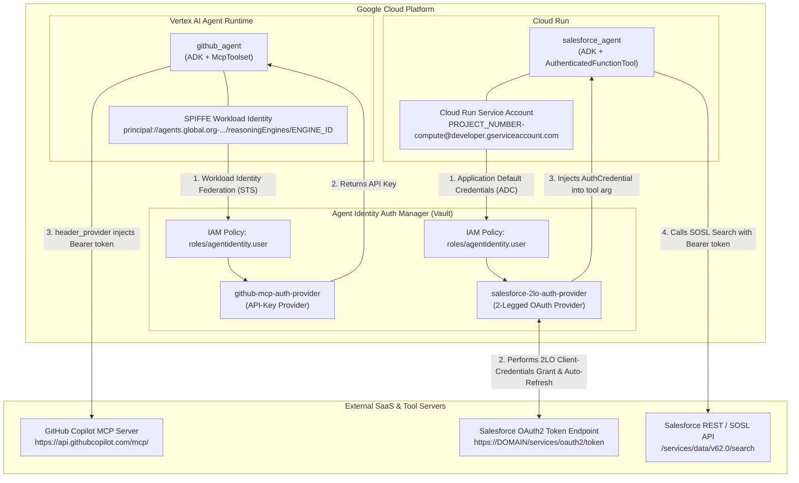
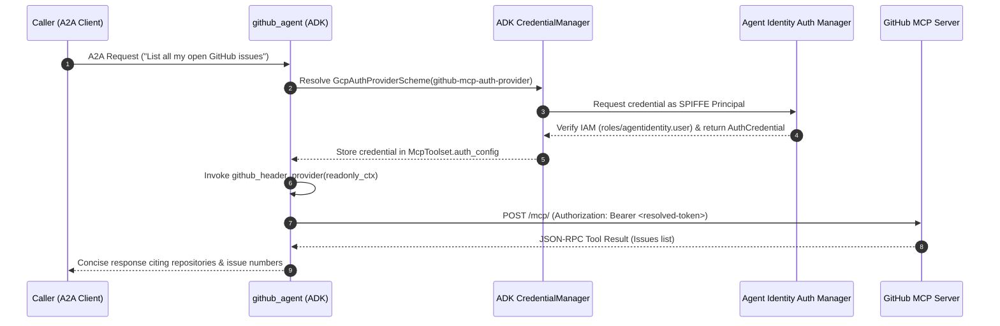
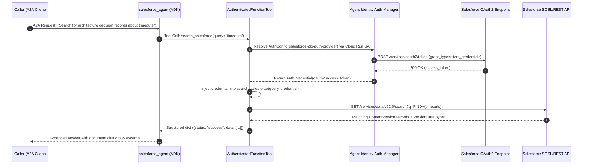

# Architectural Deep Dive: Zero-Secret Multi-Agent Authentication with Google Cloud Agent Identity Auth Manager

## 1. Problem Statement: The Liability of Static Tool Secrets

In traditional multi-agent deployments, specialist agents that interact with third-party SaaS platforms (such as GitHub or Salesforce) frequently store API tokens or OAuth client secrets in `.env` files or container environment variables:

- **GitHub Specialist Agent (Before):** Read `GITHUB_PERSONAL_ACCESS_TOKEN` from `.env` and hardcoded `Authorization: Bearer <GITHUB_TOKEN>` into its `McpToolset` HTTP connection parameters.
- **Salesforce Specialist Agent (Before):** Read `SALESFORCE_CLIENT_ID` and `SALESFORCE_CLIENT_SECRET` from `.env`, manually executed `POST /services/oauth2/token` (`grant_type=client_credentials`), cached tokens in ADK session state, and implemented custom `401` retry logic.

### Risks of Static Secrets
1. **Broad Blast Radius:** Anyone with read access to deployment configurations, container specs, or source archives can extract raw third-party credentials.
2. **Coupled Credential Rotation:** Rotating a compromised or expiring token requires modifying configuration files and redeploying every agent that consumes the secret.
3. **No Per-Workload Auditability:** Shared static secrets cannot distinguish which specific agent runtime instance requested access, nor can access be revoked immediately via Google Cloud IAM.

---

## 2. Target Architecture: Agent Identity + Auth Manager

Google Cloud **Agent Identity** and **Agent Identity Auth Manager** decouple **who the agent is** (Workload Identity) from **what external credentials the agent is authorized to read** (Auth Providers):

---

## 3. Dual-Runtime Identity Model

Because our two specialist agents run on different Google Cloud compute substrates, they authenticate to Auth Manager using two distinct workload identity primitives—both governed by the same IAM role (`roles/agentidentity.user`):

| Dimension | `github-agent` | `salesforce-agent` |
| :--- | :--- | :--- |
| **Compute Runtime** | Vertex AI Agent Runtime (`ReasoningEngine`) | Google Cloud Run (`Service`) |
| **Workload Identity Type** | Google-managed **SPIFFE Principal** (`identityType: AGENT_IDENTITY`) | Google Cloud **Service Account** via ADC |
| **IAM Member Format** | `principal://agents.global.org-<ORG_ID>.system.id.goog/resources/aiplatform/projects/<PROJECT_NUMBER>/locations/<REGION>/reasoningEngines/<ENGINE_ID>` | `serviceAccount:<SERVICE_ACCOUNT_EMAIL>` |
| **Auth Provider Type** | **API Key** (`github-mcp-auth-provider`) | **2-Legged OAuth / 2LO** (`salesforce-2lo-auth-provider`) |
| **ADK Tool Integration** | `McpToolset` + `GcpAuthProviderScheme` + `header_provider` | `AuthenticatedFunctionTool` + `AuthConfig` + injected `AuthCredential` |

---

## 4. Runtime Token Exchange Lifecycles

### 4.1 MCP Tool Delivery (`github-agent`)

For remote MCP servers (`McpToolset`), the tool implementation lives inside the ADK framework rather than a user-written Python function. Therefore, the credential cannot be passed as a Python function argument; instead, it is intercepted and injected into outbound HTTP headers via `header_provider`:

### 4.2 Function Tool Delivery (`salesforce-agent`)

For custom Python tools (`search_salesforce`), the ADK wraps the function in an `AuthenticatedFunctionTool`. Before executing the Python function, the ADK resolves the 2LO credential from Auth Manager and passes it directly as the `credential: AuthCredential` argument—while hiding `credential` from the Gemini model's function-calling schema:

---

## 5. Before vs. After Code Comparison

### 5.1 GitHub Agent (`github-agent/agent/agent.py`)

| Aspect | Before (Static `.env` Secret) | After (Agent Identity Auth Manager) |
| :--- | :--- | :--- |
| **Environment Variable** | `GITHUB_PERSONAL_ACCESS_TOKEN=ghp_...` | `GITHUB_AUTH_PROVIDER_URI=projects/.../authProviders/github-mcp-auth-provider` |
| **Provider Registration** | None | `CredentialManager.register_auth_provider(GcpAuthProvider())` |
| **Header Construction** | Static dict: `headers={"Authorization": f"Bearer {GITHUB_TOKEN}"}` | Dynamic callback: `header_provider=github_header_provider` + `auth_scheme=github_auth_scheme` |

### 5.2 Salesforce Agent (`salesforce-agent/app/`)

| Aspect | Before (Manual 2LO in Code) | After (Agent Identity Auth Manager) |
| :--- | :--- | :--- |
| **Environment Variables** | `SALESFORCE_DOMAIN`, `SALESFORCE_CLIENT_ID`, `SALESFORCE_CLIENT_SECRET` | `SALESFORCE_DOMAIN`, `SALESFORCE_AUTH_PROVIDER_URI` (Secrets removed) |
| **`SalesforceClient.__init__`** | Accepted `domain`, `client_id`, `client_secret` | Accepts only `domain` and `api_version`; derives `self.instance_url = f"https://{self.domain}"` |
| **Token Acquisition** | `SalesforceClient.authenticate()` + session state TTL cache + `401` retry | Deleted from code; managed entirely by `salesforce-2lo-auth-provider` |
| **Tool Definition** | Plain function `search_salesforce(query, tool_context)` | `AuthenticatedFunctionTool(func=search_salesforce, auth_config=salesforce_auth_config)` with injected `credential: AuthCredential` |
